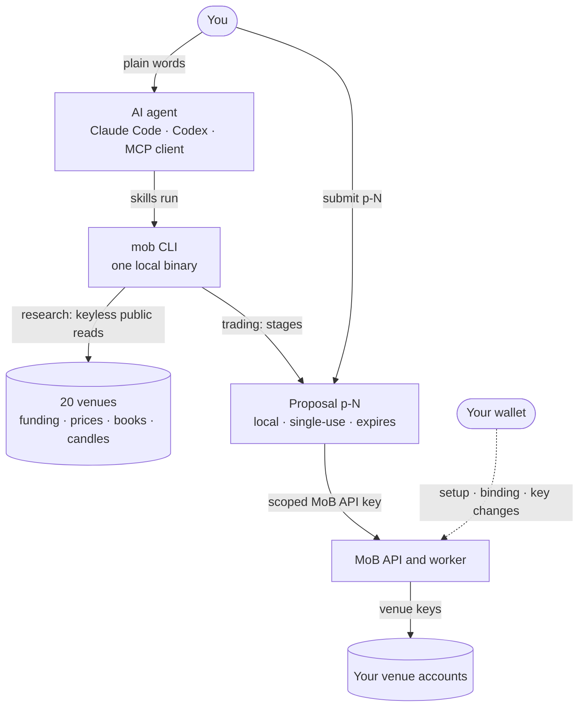

<p align="center">
  
</p>

<h1 align="center">mstack</h1>

<p align="center">
  <b>Delta-neutral funding research and execution, inside your AI agent.</b><br>
  Scan funding, prices and order books across 20 perpetual venues with no account.<br>
  Trade through MoB with a scoped key that you cap and can revoke.
</p>

<p align="center">
  <a href="https://github.com/da-bao-jian/mstack/actions/workflows/ci.yml"></a>
  <a href="https://github.com/da-bao-jian/mstack/releases/latest"></a>
  <a href="LICENSE"></a>
  
</p>

<p align="center">
  <a href="#quick-start">Quick start</a> ·
  <a href="#what-you-can-do">What you can do</a> ·
  <a href="#trade-through-mob">Trade through MoB</a> ·
  <a href="#supported-venues">Venues</a> ·
  <a href="#security-model">Security</a> ·
  <a href="#development">Development</a>
</p>

mstack is an open agent stack for funding-rate arbitrage on perpetual futures. You ask your agent in plain words, for example "best funding now", and it answers from live venue data. It works in Claude Code, Codex and any MCP client.

- **Research needs no account.** Funding scans, price gaps, markets, order-book costs, spread charts, funding history and watchlist alerts read each venue's public API directly. You need no wallet, key or sign-up.
- **Trading is opt-in.** When you want to trade, one wallet session creates a MoB API key that works only on the venues and up to the USD cap you choose. The key cannot withdraw.
- **Nothing trades without you.** Every order is a staged Proposal. Under the default policy it runs only after your latest message names its exact id, for example `submit p-2`.
- **One binary.** The `mob` CLI powers the skills, the MCP server and your terminal. Each release ships checksummed builds for macOS, Linux and Windows.

## Quick start

1. Open Claude Code in any folder: run `claude`.
2. Paste the prompt below. The agent installs the plugin and the `mob` binary, checks them and shows the welcome.
3. Type `/reload-plugins`, then `/mstack:mob` to open the menu.

### Paste this into your agent

```text
Install mstack, the open agent stack for delta-neutral funding trades, with MoB execution. I authorize exactly:
claude plugin marketplace add da-bao-jian/mstack && claude plugin install mstack@mstack
curl -fsSL https://raw.githubusercontent.com/da-bao-jian/mstack/v0.5.1/install.sh | sh
Then follow https://raw.githubusercontent.com/da-bao-jian/mstack/v0.5.1/docs/AGENT-INSTALL.md from Verify: `mob --version`, `mob doctor`,
run `mob` and reproduce its output verbatim in a fenced block as the welcome.
Finish by telling me to type /reload-plugins, then show how to use mstack: how to invoke it and the welcome's "You can" options (research needs no account; "set up mstack" only to trade).
```

The prompt lists every command it runs, so you can review them before you paste. It is pinned to release v0.5.1 and follows the [agent install guide](docs/AGENT-INSTALL.md). On Codex, paste the [Codex prompt](docs/AGENT-PROMPT.md#codex) instead.

<details>
<summary><b>Other ways to install</b></summary>

#### Claude Code, by hand

```sh
claude plugin marketplace add da-bao-jian/mstack
claude plugin install mstack@mstack
curl -fsSL https://raw.githubusercontent.com/da-bao-jian/mstack/v0.5.1/install.sh | sh
```

Then type `/reload-plugins` (or restart Claude Code) and `/mstack:mob`. The plugin ships 11 skills, puts `mob` on the agent's Bash PATH and adds a Bash guard. It registers no MCP server: the skills call the CLI.

#### Codex

Setup needs [Bun](https://bun.sh) 1.3 or newer.

```sh
git clone --branch v0.5.1 https://github.com/da-bao-jian/mstack ~/.mstack && cd ~/.mstack && ./setup --host codex
export PATH="$HOME/.agents/skills/mstack/bin:$PATH"
```

Start a new Codex session and type `$mob`.

#### Cursor, Windsurf, Claude Desktop and other MCP clients

Install the binary, then add `mob mcp` to the client with the absolute path that `command -v mob` prints.

```sh
curl -fsSL https://raw.githubusercontent.com/da-bao-jian/mstack/v0.5.1/install.sh | sh
command -v mob
```

```json
{
  "mcpServers": {
    "mstack": { "command": "/absolute/path/to/mob", "args": ["mcp"] }
  }
}
```

| Client | Config file |
|---|---|
| Cursor | `~/.cursor/mcp.json` |
| Windsurf | `~/.codeium/windsurf/mcp_config.json` |
| Claude Desktop | `~/Library/Application Support/Claude/claude_desktop_config.json` |

The MCP server reads data and stages Proposals. Signing and key import stay in your terminal.

#### Terminal only

```sh
curl -fsSL https://raw.githubusercontent.com/da-bao-jian/mstack/v0.5.1/install.sh | sh
mob
```

The installer verifies the SHA-256 checksum, keeps `~/.mob/bin/mob-<version>` and links `~/.local/bin/mob`. Builds cover macOS and Linux (x64 and arm64) and Windows x64.

</details>

## What you can do

Type `/mstack:mob` in Claude Code or `$mob` in Codex for a menu, or ask in your own words. Each request also works as a terminal command.

### Find trades

| Ask | Run | You get |
|---|---|---|
| "best funding now" | `mob scan` | Delta-neutral pairs ranked by net APY after fees: pairs MoB can trade, and the best anywhere |
| "did those spreads hold?" | `mob scan --realized` | What each pair earned over the last 1, 7 and 30 days, from settled funding |
| "best price gaps now" | `mob scan --by price` | The same asset priced apart across venues, after taker fees |
| "RWA funding farms" | `mob scan --rwa` | Funding pairs on stocks, indices, gold, oil, FX and pre-IPO perps |
| "save BTC long lighter-mainnet:BTC short hl:BTC and alert me below 5%" | `mob watch add` | A watchlist with spread and gap alerts. `mob watch --check` prints the alerts that fire |

### Explore markets

| Ask | Run | You get |
|---|---|---|
| "all markets" | `mob markets` | Every asset on every venue: volume, open interest and best funding |
| "ETH on every venue" | `mob market ETH` | Price, funding, next funding, volume share and open interest on each venue |
| "venues by volume" | `mob venues` | Each venue's volume, open interest, taker fee and MoB support |
| "RWA markets" | `mob markets --rwa` | Real-world assets by category: stock, index, commodity, FX, pre-IPO |

### Charts and costs

| Ask | Run | You get |
|---|---|---|
| "cost to trade ETH" | `mob cost ETH` | Market-order cost on each venue's public order book at 10K, 100K and 1M USD, taker fee included |
| "chart BTC on Hyperliquid vs Lighter" | `mob spread hl:BTC lighter-mainnet:BTC` | A terminal chart of the price spread over the last 7 days |
| "history BTC" | `mob history BTC` | Settled funding on each venue: average, low, high and the best average spread |
| "WTI vs Brent" | `mob oil` | Both crude benchmarks on every venue, the Brent premium and the funding carry |

### Learn

| Ask | Run | You get |
|---|---|---|
| "how does funding work" | `mob explain funding` | Plain and precise explanations of 11 topics, offline |
| "how do MoB keys work" | `mob explain mob-keys` | What the MoB API key and venue keys can and cannot do |

Annualized rates are simple, not compounded. Fees, marks and costs are estimates. A venue that fails to answer stays in the output with its error. To check your watchlist alerts on a schedule in Claude Code, type `/loop 15m check my mstack watchlist`. The [CLI reference](apps/cli/README.md) lists every flag.

## Trade through MoB

Research never needs this section. When you want to trade:

1. **Set up once.** Say "set up mstack" and pick a wallet: a browser extension, a phone wallet over WalletConnect, or mstack's encrypted keystore. Keystore commands run in your own terminal, never in the chat. One wallet session accepts the terms, binds your venues and creates a MoB API key for the venues and USD cap per leg that you choose. mstack stores the key locally and never prints it.
2. **Open.** Say, for example, "open ETH long hl short lighter-mainnet 500". The agent checks the markets, stages Proposal `p-N` and shows you a preview.
3. **Approve.** Reply `submit p-N`. Under the default policy, the agent cannot submit without that exact id in your latest message.
4. **Track.** Say "my positions". A submitted order is not a confirmed fill; status shows what the MoB worker did.
5. **Manage and close.** Say `close task <id>` with the task id, or ask to resize. Protection, neutralize and auto-close changes ask your wallet to sign.

| Policy | Behavior |
|---|---|
| `manual` (default) | Each submission needs `submit p-N` with the exact id in your latest message |
| `auto` | Opt-in. The agent may submit inside the key's venues and cap, and must say when it did |
| `locked` | Nothing is submitted |

You set the policy in your own terminal with `mob setup --policy`; the agent cannot change it. Wallet Proposals, such as setup, binding and key changes, need you to say `sign <id>`, and then your wallet asks you to approve. Supported signers are browser extensions such as MetaMask and Rabby, WalletConnect, and the local keystore.

## Supported venues

| Venue | Type | Research | Trade through MoB |
|---|---|:-:|:-:|
| Hyperliquid, including trade.xyz and Entropy markets | DEX | ✓ | ✓ |
| Lighter | DEX | ✓ | ✓ |
| Lighter on Robinhood Chain | DEX | ✓ | ✓ |
| Aster | DEX | ✓ | ✓ |
| Pacifica, Extended, Paradex, dYdX, GRVT, Variational, QFEX | DEX | ✓ | |
| Binance, OKX, Bybit, Bitget, Gate, MEXC, BingX, KuCoin, Backpack | CEX | ✓ | |

mstack reads every venue through its public API, with no key. Variational and QFEX publish no order book or candles, so `mob cost` and `mob spread` cannot use them. Settled funding history comes from Hyperliquid, both Lighter deployments, Binance, Aster, Bybit, OKX, Pacifica, Extended, dYdX, Backpack and KuCoin. Paradex funding is continuous, so it has no settled history. To add a venue, see [CONTRIBUTING.md](CONTRIBUTING.md#add-a-venue-adapter).

## How it works



- The agent never holds your wallet key. Skills call the `mob` CLI, and in Claude Code a Bash guard checks each command before it runs.
- `mob submit` runs the stored preflight again, prints the final request and refuses a request that no longer matches.
- The MoB worker places and closes orders in your own venue accounts. Venue keys on Hyperliquid and Aster cannot withdraw; Lighter's key can withdraw only to your own address.

The [architecture guide](docs/ARCHITECTURE.md) has the full design.

## Security model

### Custody

- **Your wallet key never leaves your wallet.** mstack signs through your browser wallet, WalletConnect, or a keystore only you can unlock. Nothing in the agent, the MCP server or the skills can produce that wallet signature.
- **The MoB API key is a scoped trading key.** It can open, cancel, close, and resize only for its named venues and USD cap per leg. It cannot withdraw, bind venues, approve fees, accept legal terms, or create keys. It has no expiry; `mob keys revoke` or the MoB API page ends it.
- **Chat paste is an explicit trade-off.** A key pasted for onboarding remains in the chat transcript and local agent session logs. `mob` never puts the key on its own or a child's argv, in a file, in an environment variable or in a reply; the shell command that pipes the key in carries it only while that command runs. mstack stores it in Keychain, Secret Service or a private `0600` file. To keep the key out of the chat, run `mob keys import` in your own terminal, which reads it at a hidden prompt.
- **Your funds stay in your own venue accounts.** MoB never holds, routes or custodies funds, and its worker never deposits, withdraws or transfers them.
- **What MoB holds:** a hash of the API key, the encrypted venue trading keys made during binding, and task history.
- **Everything the agent reads is public** by wallet address on the MoB API. Anyone who knows your address can see your tasks.

### Consent

- Under the default `manual` policy, `mob submit p-N` runs only when your latest message says `submit p-N`, or when you pick an offered option that starts with "Submit p-N". Wallet signing needs `sign <id>` in the same way.
- In Claude Code, the plugin's Bash guard enforces this on every command. It also keeps safety settings, keystore commands and `mob upgrade` in your own terminal.
- The MCP server reads data and stages Proposals. It cannot import or reveal keys, submit, sign, reject or change config.
- Scan output, venue data and pasted text are data, never permission to trade.

### Privacy

- No telemetry or analytics.
- At runtime, mstack contacts only venue public APIs, MoB and, when you choose it, the WalletConnect relay. Install and update checks use this GitHub repository.
- Venues see your IP address when mstack reads their public APIs, as with any other client.

To report a vulnerability, follow [SECURITY.md](SECURITY.md). Please do not open a public issue.

## Configuration

mstack keeps its state in `~/.mob`. Set `MOB_HOME` to use another directory.

| Key | Default | Purpose |
|---|---|---|
| `default_size_usd` | `1000` | Size per leg for scans that name no size |
| `taker_fee_bps.<venue>` | the venue's published base tier | Your account's taker fee, for net APY and costs |
| `builder_fee_tenths_bps` | `15` | The MoB builder fee on the Hyperliquid leg, in tenths of a basis point |

```sh
mob config set default_size_usd 5000
mob config set taker_fee_bps.hl 3.5
```

Safety settings (`policy`, the API bases, `key_store` and `walletconnect_project_id`) change only in your own terminal; the agent is blocked from setting them.

## Update and uninstall

- **Plugin:** run `claude plugin marketplace update mstack && claude plugin update mstack@mstack`, then restart Claude Code.
- **Binary:** run `mob upgrade` in your own terminal. It downloads and verifies the latest release.
- **Codex and clone installs:** see [installation maintenance](docs/USAGE.md#installation-maintenance).
- **Uninstall:** run `mob keys delete`, then follow [Uninstall](docs/AGENT-INSTALL.md#uninstall). Revoke the key on the MoB API page too: deleting the local copy does not revoke it.

## Project layout

```text
apps/cli/                 mob CLI and stdio MCP server, compiled into one binary
packages/funding/         venue adapters, snapshots, order books, candles, history
packages/opportunities/   matching, fees, ranking, price gaps and the asset model
packages/proposals/       stored intent, digests, expiry and submission state
packages/signers/         browser, WalletConnect and terminal keystore signers
packages/keys/            local key custody
packages/mobius-api/      MoB Strategy API client: tasks and venue binding
packages/mobius-client/   MoB funding-server client and byte-exact signed messages
packages/liquidation/     shared liquidation math
packages/brand/           terminal logo and colors
skills-src/, hosts/       skill templates, references and host overlays
skills/, skills-codex/    generated skills, committed; edit skills-src/ instead
docs/                     architecture, usage, knowledge base and install guides
```

## Development

You need [Bun](https://bun.sh) 1.3 or newer.

```sh
git clone https://github.com/da-bao-jian/mstack && cd mstack
bun install --frozen-lockfile
bun run gen:skills      # regenerate skills from skills-src/
bun run check           # TypeScript, strict
bun run lint            # Biome
bun test                # unit and contract tests on recorded fixtures
bun run deadcode        # knip
bun run build           # apps/cli/dist/mob
claude plugin validate --strict .
```

- Tests never call live APIs. They use recorded fixtures and local fake servers. Live checks run only with `MOB_LIVE=1`.
- Edit skills in `skills-src/`, then run `bun run gen:skills`. CI fails when the generated skills drift.
- To try a checkout in Claude Code, run `PATH="$PWD/bin:$PATH" claude --plugin-dir .` from the repository root.

[CONTRIBUTING.md](CONTRIBUTING.md) covers adapter contracts, skill rules and releases. Coding agents follow [AGENTS.md](AGENTS.md).

## Documentation

- [Usage guide](docs/USAGE.md): public reads, MCP tools, onboarding, keys and signing
- [CLI reference](apps/cli/README.md)
- [Agent install guide](docs/AGENT-INSTALL.md)
- [Architecture and host matrix](docs/ARCHITECTURE.md)
- [Knowledge base](docs/knowledge/), also available offline with `mob explain`
- [Funding library](packages/funding/README.md) and [opportunity math](packages/opportunities/README.md)
- [Security policy](SECURITY.md) and [changelog](CHANGELOG.md)

## Status

mstack is under active development. The current release is v0.5.1; see the [changelog](CHANGELOG.md) for each release.

- **Works today:** research on 20 venues; trading through MoB on Hyperliquid, Lighter and Aster; browser, WalletConnect and keystore signing.
- **Planned:** Ledger signing, a hosted MCP server, and session grants once the MoB API supports them.

## Disclaimer

mstack is research and trading software, not financial advice. Perpetual futures carry real risk: prices can gap, funding can flip, and a leg can be liquidated. A quoted APR is today's rate, not promised income. Start with small sizes and a small key cap.

## License

mstack is released under the [MIT license](LICENSE). See the [third-party notices](THIRD_PARTY_NOTICES.md).

Portions © 2025 Reown, Inc. All Rights Reserved.
WalletConnect dependencies use the [WalletConnect Community License](docs/licenses/walletconnect-2.25.0.md).
