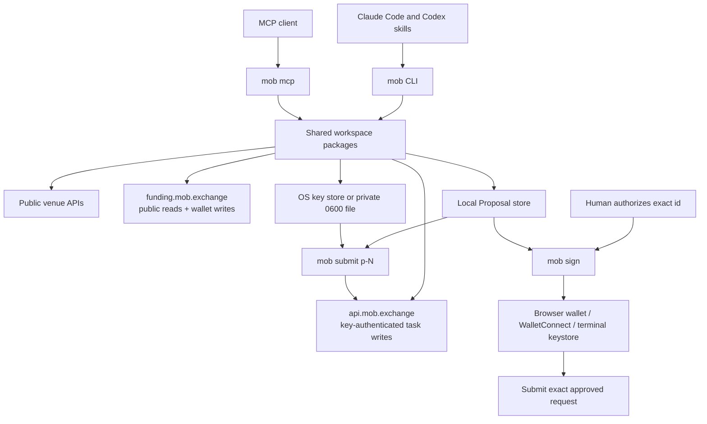

# Architecture

mstack puts public funding reads, scoped API-key trading, and manual wallet
Proposals behind one `mob` binary. CLI, skills, and stdio MCP share adapters,
math, preflight, and local Proposal storage.

## One binary

Bun compiles the CLI, stdio MCP, knowledge pages, signing UI, and WalletConnect
worker into the distribution. A built binary runs without Bun or `node_modules`.
Shared code prevents CLI and MCP math or preflight from drifting.
`bin/mob` is a text shim with this resolution order:

1. Use an executable `MSTACK_MOB_BIN` override; an invalid override fails.
2. Use the checkout's `apps/cli/dist/mob` if executable.
3. Use `~/.mob/bin/mob-<plugin-version>` if executable.
4. If Bun and CLI source exist, install frozen dependencies and build once.
   A build failure stops; it does not fall through to a download.
5. Otherwise run `install.sh --version <plugin-version> --cache-only`, verify SHA-256,
   cache, and execute the release binary. Failure prints explicit installation options.

Resolution is quiet unless `MSTACK_VERBOSE=1`. Builds, downloads, and failures go to
stderr so MCP stdout remains protocol data. Plugin versions remain pinned to their
manifests; standalone downloaded upgrades select the latest release.

The release workflow produces five platform binaries, `VERSION`, and `SHA256SUMS`.
It verifies checksums before publication. The installer and downloaded upgrade path
verify the selected asset before replacing a cache file or command link. Releases
use HTTPS and SHA-256, without platform signatures or macOS notarization.
W14 and W16 add no packages; see [third-party notices](../THIRD_PARTY_NOTICES.md).

`packages/funding` fetches and validates public venue data. `packages/opportunities`
matches base tickers and ranks net funding estimates. `packages/mobius-client`
contains funding-server routes and message builders. `packages/mobius-api` owns
the Strategy API contract. `packages/keys` owns local key custody.
`packages/proposals`, `packages/signers`, and `packages/liquidation` own local
intent, manual signing, and protection math.

## Proposals, submission, and signing

Mutation commands stage a Proposal and stop. Wallet Proposals pin the request,
exact message or typed data, digest, local preflight, owner, and five-minute
expiry. API Proposals pin the Strategy API body and an idempotency key before
the first send. Policy, expiry, owner, and single-use checks fail closed.
Submission does not prove execution.

Manual policy requires the latest user message to name the exact id before
`mob submit` or browser signing. Auto policy permits only API Proposals inside
the stored key scope and cap. Keystore secrets belong in the human's terminal.
MCP has no key import/reveal, submission, signing, rejection, or config-write tool.
See [security boundaries](../SECURITY.md) and [usage](USAGE.md).

## Fail-fast data

Each adapter rejects malformed data. The snapshot records a failed venue in
`failed[]` and preserves other successful venues. It never substitutes stale rates.
Native market strings survive matching. Annualization is simple, not compounded.
Fees and mark-based entry costs are estimates; marks do not establish fill depth.
Tests use recorded responses, injected clocks, and local fake servers.

## Funding-server and Strategy API paths

The funding-server path uses wallet-signed requests for legal acceptance,
binding, key administration, protection, neutralization, auto-close, and
size-mismatch edits. Public task reads remain available by owner address.

The Strategy API path uses `Authorization: Bearer <key>` for task list/get and
open, cancel, close, and resize. Every POST uses a Proposal-bound idempotency
key. The key is limited to named venues and a maximum USD size per leg. It
cannot withdraw, bind venues, approve fees, accept legal terms, or create keys.
Client errors redact the bearer.

Both paths share local preflight using readiness, venue metadata, marks, and
shared math. Server validation remains the final gate. The CLI does not set
leverage or margin mode. Unsupported maintenance-margin data fails closed.

The hosted snapshot, hosted MCP, and server nonces remain future work. Planned
PRD examples must not be read as implemented routes or guarantees.

## Plugin root and packaging trade-off

The repository root is the Claude Code plugin root. Marketplace installation
copies the repository, including the source, workspaces, scripts, and lockfile
needed by `bin/mob`. Moving only the manifest and skills into a subfolder would
strand the build shim. The manifest's marketplace entry uses `source: "./"`.

Claude Code detects the root `bun.lock` for automatic dependency installation.
Eligible registry dependencies install during caching, with lifecycle scripts disabled.
The current loader excludes workspace dependencies, so this monorepo cannot rely
on that install. The source shim runs its own frozen install before building.
The root lockfile remains a directory review hold. These install-time effects are
deliberate. See the [loader limits](https://code.claude.com/docs/en/plugins/loading#limits-on-the-dependency-install).
The top-level `bin/` also prevents claude.ai and Cowork from loading
this plugin. Current distribution is through our own Claude Code marketplace.
A future P2 listing will use a separate skills-only plugin over hosted MCP.
That plugin and service are not shipped here.

MCP uses the plain `${CLAUDE_PLUGIN_ROOT}/bin/mob` command path. No shell wrapper
is embedded in that command. SessionStart is not used to display an install notice.
The CLI hint mechanism for Anthropic's official marketplaces does not apply to ours.
The Bash hook executes `mob hook sign-guard` through the same shim, so a compiled
installation can enforce the existing guard without Bun.

## Host matrix

| Host | Installation and invocation | Signing boundary |
|---|---|---|
| Claude Code plugin | Own marketplace; `/mstack:mob` and `/mstack:mob-*` | Skill approval plus Bash sign guard; wallet still approves |
| Claude Code clone | `./setup --host claude`; `/mob` and `/mob-*` | Skill approval; clone skills alone do not install the plugin hook |
| Codex | `./setup --host codex`; `$mob` and `$mob-*` | Skill rules and CLI checks; no Claude hook |
| Other stdio MCP clients | Absolute `mob` path with `mcp` argument | Reads and local staging only |
| claude.ai / Cowork | Root plugin unsupported because of `bin/` | Future separate skills-only plugin and hosted MCP |

Codex links go to `~/.agents/skills`. Existing `~/.codex/skills` receives compatibility
links; it is not the documented primary path. The installer records its links and
removes only owned links on uninstall, preserving user replacements.

## Agent instructions and skills

One root `AGENTS.md` contains contributor facts. Claude Code can read it when no
applicable `CLAUDE.md` exists; Codex reads it through its project instruction chain.
Process history lives separately in `PROCESS.md`. Tests bound the file to 200 lines.

Skill templates generate portable frontmatter, host prompts, and direct references.
Codex also gets minimal `agents/openai.yaml` display metadata. Each skill stays under
120 lines. The router keeps standing rules in context; mutation skills keep their
explicit approval rules. Reference files contain conditional explanations.

`bin/mob-preamble` resolves its physical location and executes the shared script.
Every skill uses the shared hourly splash, scoped by configured owner or `MOB_HOME`.
The router adds `--router` to show it on every invocation. The preamble prints
`MOB_BIN` for later commands because a child shell cannot export variables or PATH
to its parent.

Official convention URLs and validation results are recorded in [W13](reports/W13.md).
